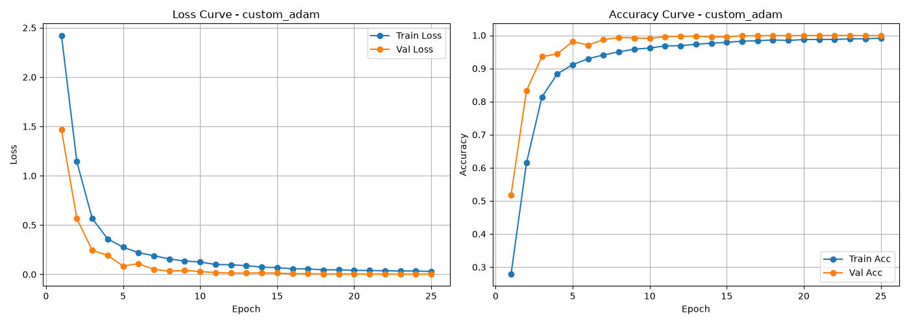
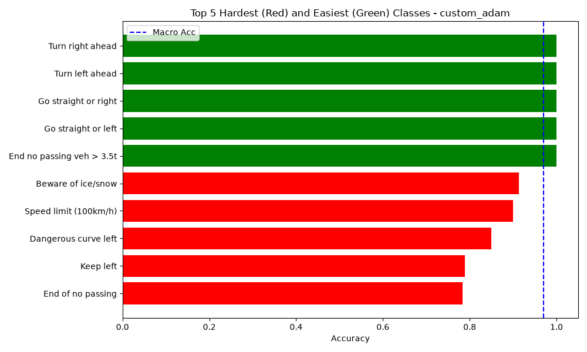
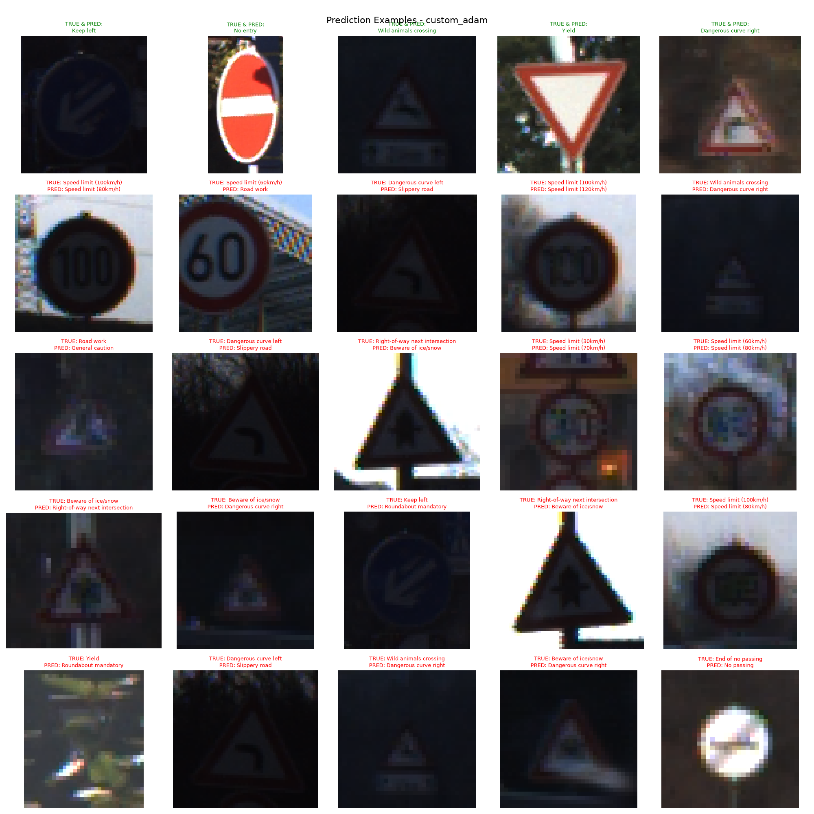

# GTSRB - Traffic Sign Recognition with Deep Convolutional Neural Networks

Classificador de alto desempenho baseado em **PyTorch** para o benchmark alemão de placas de trânsito (**GTSRB** - *German Traffic Sign Recognition Benchmark*, 43 classes e 12.630 imagens de teste).

O projeto implementa uma investigação experimental sistemática entre uma arquitetura rasa de referência (*Baseline*) e uma rede convolucional profunda modularizada (*Custom*), incorporando *Batch Normalization*, regularização estocástica via *Dropout*, transformações afins com *Random Erasing* e agendamento de taxa de aprendizado (*Cosine Annealing*).

---

## 1. Resultados Principais e Benchmark

Avaliação conduzida sobre o conjunto de teste oficial descorrelacionado (12.630 amostras):

| Métrica / Parâmetro | `BaselineModel` (Adam) | `CustomModel` (Adam + Cosine) | Ganho Absoluto ($\Delta$) |
| :--- | :---: | :---: | :---: |
| **Acurácia Global (Test)** | 92.11% | **98.08%** | **+5.97%** |
| **Acurácia Macro (Test)** | 88.73% | **96.96%** | **+8.23%** |
| **Acurácia Máxima de Validação** | 99.40% | **99.96%** | +0.56% |
| **Menor Loss de Validação** | 0.0334 | **0.0024** | **-92.8%** |
| **Resolução de Entrada** | $32 \times 32$ | **$48 \times 48$** | $+125\%$ pixels |
| **Capacidade Representativa** | 3 blocos (32 canais base) | **4 blocos (64 canais base)** | Escala multi-nível |
| **Regularização e Schedulers** | Nenhuma | BatchNorm, Dropout (0.3), Cosine Annealing | Alta generalização |

> **Destaque:** O modelo customizado alcançou **98.08% de acurácia global**, com um aumento de **+8.23% na acurácia macro**, comprovando alta sensibilidade mesmo em classes raras com baixo suporte amostral.

---

## 2. Dinâmica de Treinamento e Convergência

A combinação de *Batch Normalization*, *Dropout (0.3)* e decaimento suave via *Cosine Annealing Learning Rate* garantiu estabilidade assintótica aos gradientes, eliminando oscilações espúrias e mitigando *overfitting*:



---

## 3. Diagnóstico de Desempenho e Análise de Erros

### A. Classes Extremas (Top-5 Fáceis vs. Mais Desafiadoras)
Identificação das categorias de placas com maior e menor precisão no conjunto de teste. Placas com alta redundância de traços circulares e numéricos (como limites de velocidade) representam os maiores desafios de discriminação fina:



### B. Inspeção Qualitativa de Inferência
Amostragem empírica de predições reais do modelo customizado no conjunto de teste: 5 classificações corretas comparadas a 20 casos de erro causados por subexposição severa, borrões de movimento ou oclusões parciais:



---

## 4. Engenharia de Arquitetura

### `CustomModel` (CNN Profunda Modular)
Entrada: Tensores normalizados de dimensão $(3 \times 48 \times 48)$.

```text
Input (3, 48, 48)
 │
 ├── [Bloco 1] Conv2d(3, 64, k=3, p=1)   -> BatchNorm2d -> ReLU -> MaxPool2d(2, 2)  => (64, 24, 24)
 ├── [Bloco 2] Conv2d(64, 128, k=3, p=1) -> BatchNorm2d -> ReLU -> MaxPool2d(2, 2)  => (128, 12, 12)
 ├── [Bloco 3] Conv2d(128, 256, k=3, p=1)-> BatchNorm2d -> ReLU -> MaxPool2d(2, 2)  => (256, 6, 6)
 ├── [Bloco 4] Conv2d(256, 512, k=3, p=1)-> BatchNorm2d -> ReLU -> MaxPool2d(2, 2)  => (512, 3, 3)
 │
 ├── AdaptiveAvgPool2d((1, 1))                                                        => (512, 1, 1)
 ├── Flatten()                                                                        => (512)
 ├── Linear(512, 256) -> ReLU -> Dropout(p=0.3)
 └── Linear(256, 43)                                                                  => Logits (43 classes)
```

### `BaselineModel` (CNN Rasa de Referência)
Composta por 2 blocos convolucionais $(32 \rightarrow 64)$ sobre resolução $(3 \times 32 \times 32)$, sem normalização por lote e finalizando em camadas densas diretas.

---

## 5. Estrutura do Código e Design Modular

O projeto foi construído sob separação estrita de responsabilidades:

```text
IA/
├── experiments.py              # CLI principal para orquestração de suítes experimentais
├── plots.py                    # Geração determinística de gráficos analíticos e matrizes
│
├── src/
│   ├── core/types.py           # Dataclasses imutáveis tipadas (ModelConfig, Hyperparameters)
│   ├── models/
│   │   ├── factory.py          # ModelFactory para resolução dinâmica de arquiteturas
│   │   ├── custom.py           # Implementação da CustomModel com BlockConfig
│   │   └── baseline.py         # Implementação da BaselineModel de referência
│   ├── pipe/
│   │   ├── pipeline.py         # Orquestrador desacoplado (Carregamento -> Treino -> Teste -> Dump)
│   │   ├── training.py         # Loop de treino/validação com Early Stopping e Schedulers
│   │   └── testing.py          # Rotina de inferência e cálculo de métricas agregadas
│   └── utils/
│       ├── args.py             # Parser robusto de argumentos de linha de comando
│       └── gtsrb.py            # Pipeline de download e carregamento dos conjuntos GTSRB
│
├── results/                    # Métricas consolidadas e gráficos analíticos versionados
│   ├── metrics_summary.csv     # Tabela de resultados agregados
│   └── runs/                   # Gráficos e históricos detalhados por execução
│
└── requirements.txt            # Dependências fixadas de ambiente
```

---

## 6. Guia de Instalação e Execução

### Configuração do Ambiente
```bash
python -m venv venv
source venv/bin/activate   # Windows: .\venv\Scripts\activate
pip install -r requirements.txt
```

### Execução de Experimentos via Linha de Comando
```bash
# Treinar a arquitetura profunda recomendada (Custom + Adam + Cosine)
python experiments.py --custom

# Treinar a arquitetura baseline de referência
python experiments.py --baseline

# Executar estudos comparativos de ablação
python experiments.py --compare-optimizers
python experiments.py --compare-norm

# Gerar figuras analíticas e compilar o CSV de métricas
python plots.py
```

---

## 7. Co-autoria e Responsabilidades Técnicas

| Autor | Responsabilidade Técnica Principal |
| :--- | :--- |
| **João Pedro Sant'Ana de Carvalho** ([@santcjoao](https://github.com/santcjoao)) | Arquitetura do pipeline modular (`Pipeline`, `Trainer`, `Tester`, `ModelFactory`), tipagem com dataclasses imutáveis, integração de otimizadores avançados (*AdamW*, *Label Smoothing*, *Cosine Annealing LR*) e CLI parametrizada. |
| **Nathan Rezende** ([@nahnn](https://github.com/nahnn)) | Pipeline de geração de figuras analíticas (`plots.py`), prototipagem da rede convolucional profunda e suítes de teste de hiperparâmetros. |
| **Thiago Fernandes** ([@thiagofernandesGS](https://github.com/thiagofernandesGS)) | Diagnóstico qualitativo de predições (`prediction_examples`), inspeção visual de casos de erro no conjunto de teste e calibração de rotinas auxiliares. |
